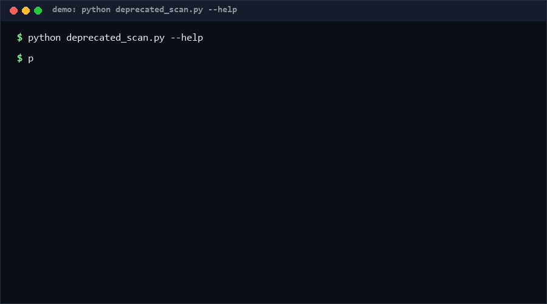

# deprecated-api-scan

deprecated-api-scan is a stdlib-only CLI that checks your source tree against a declarative deprecation manifest — each entry names a pattern, a severity, the version it disappears in, and a migration target — and reports file:line findings with fixes, escalating to "removed" once your `--target` version crosses an entry's removal line. Use it when an ecosystem move (like Python 3.12) is coming and you want one command that tells you exactly what breaks.

<p align="center"></p>

## Problem

Deprecations fail quietly: the warning scrolls past in CI logs, the code keeps running, and months later a runtime upgrade turns every ignored warning into a hard import error. Vendor tooling exists for specific ecosystems (Kubernetes YAML, IDE linting), but there is no generic, offline, grep-grade mechanism where *your team* defines what counts as deprecated in *your* codebase — including internal APIs — and gets a machine-readable migration checklist.

## How it works

1. **Manifest** — a JSON file with an `apis` list: `id`, `match` (regex or literal), `match_type`, `severity` (`info`/`deprecated`/`removed`), optional `removed_in` and `deprecated_since` versions, `replacement`, `message`. Invalid entries or regexes fail loudly at load time.
2. **Scan** — the CLI walks a file or directory (default extensions `.py/.js/.ts`, override with `--ext`), matches line-by-line, and emits findings with file, line, API id, effective severity, a trimmed evidence line, and the migration fields.
3. **Escalation and gates** — with `--target 3.12`, any entry whose `removed_in` ≤ target is reported as `removed` regardless of declared severity. `--min` filters the floor (e.g. `--min removed` for upgrade gates). Exit codes: `0` no findings, `1` findings at/above floor, `2` input errors. `--format json` yields a report for CI.

## Quickstart

Measured on a laptop, Python 3.10: total **~2 s**.

```bash
# ~0.5 s: scan the bundled legacy example against the Python 3.12 manifest
python deprecated_scan.py scan --manifest manifests/python_stdlib_sample.json \
    --path examples/legacy_app.py --target 3.12 --min removed

# ~0.5 s: JSON report for CI gates
python deprecated_scan.py scan --manifest manifests/python_stdlib_sample.json \
    --path src/ --format json

# ~1 s: self-test (49 cases)
python self_test.py
```

## Why not X

- **[mizcausevic-dev/k8s-deprecated-api-scanner](https://github.com/mizcausevic-dev/k8s-deprecated-api-scanner)** — scans Kubernetes YAML manifests for deprecated/removed apiVersion usage, purely offline. It is Kubernetes-manifest-specific with a built-in table; this repo is manifest-driven and language-agnostic, so the same tool covers Python 3.12, internal SDKs, or your own helper functions.
- **[balajmarius/vscode-jsdocs-deprecated](https://github.com/balajmarius/vscode-jsdocs-deprecated)** — surfaces `@deprecated` JSDoc usages live in the editor as you type. Excellent for the author in the loop, but editor-bound and per-file; this repo is a repo-wide, CI-runnable gate with an exit code and JSON output.
- **[scikit-rf/examples](https://github.com/scikit-rf/examples)** — a repository marked "Deprecated" as a whole — the nuclear form of deprecation signaling. Whole-repo deprecation tells you nothing about which usages remain; a line-level manifest scan does.

## Minimal Fallback (PLAN B)

No manifest infrastructure? The 80% version is a grep list in CI:

```bash
grep -rEn "import imp|ssl\.wrap_socket\(|assertEquals\(" src/ && exit 1 || exit 0
```

What you give up versus the manifest: severity floors, `removed_in` escalation by target version, machine-readable JSON, and migration text attached to each finding.

## Design Trade-offs

Priority order: **zero false obstacles (manifest validation over cleverness) > offline determinism > line-level precision > semantic depth.** Matching is literal line-text regex — no parsing, no AST — so comments and strings can produce findings (documented limitation); in exchange the tool works on any text language and never fails on weird syntax. Severity escalation is monotone (target-version comparison), never de-escalates a declared `removed`.

## Limits & Second-order Effects

- Findings in comments/strings are possible (no AST awareness); teams add `--min` floors or narrow regexes to compensate.
- Dynamic usage (`getattr(module, "imp")`) is invisible to line matching.
- Manifest drift becomes its own chore: stale entries that no longer match anything linger and lull maintainers (second-order: the checklist rots exactly like the warnings it replaced).
- Escalation by version string assumes dotted-numeric versions; exotic schemes fall back to declared severity.

## FAQ

**Can I track internal APIs, not just stdlib?** Yes — the manifest is just patterns; point them at your own function names.

**Does it modify files?** No. It reports only; rewrites stay with humans (or your codemods).

**How do I gate an upgrade in CI?** `scan ... --target <new-version> --min removed` — exit 1 blocks the merge.

**When NOT to use this tool?** (1) Kubernetes YAML apiVersion auditing — a purpose-built k8s scanner ships the full removal table already. (2) You need AST-accurate, rename-aware analysis — use a language server or lint framework with fixers. (3) You need live in-editor squiggles — use a JSDoc/IDE plugin. (4) Your "deprecations" depend on runtime configuration — a static manifest cannot express them.

## [Core Assumptions]

1. A deprecation is knowable statically: pattern in source text, not runtime behavior.
2. Version lines are dotted-numeric (`3.12`, `2026.06`); uncomparable schemes degrade to declared severity rather than guessing.
3. The manifest is team-owned truth; the tool never auto-updates it (auto-updating would hide the very decisions it exists to surface).
4. Findings are advisory output; humans or separate codemods perform migrations.

## Confidence

That the matcher, escalation, and CLI behave as documented: **High (≥80%)** — 49 self-test cases including a real Python-3.12 removal manifest. That bundled manifest facts are correct as of writing: **High** for Python 3.12 removals (imp, distutils, ssl.wrap_socket, unittest aliases, SafeConfigParser). That line-level matching suffices for large codebases without AST precision: **Medium** — expect some manual regex tuning. That manifests stay maintained over time: **Low** — see Limits.

*as of 2026-10-12*

---

Part of the [zhengming-toolbox](https://github.com/chenhz01/zhengming-toolbox) — 55 purpose-built AI-engineering tools across neglected niches.

Related tools: [doc-rot-detector](https://github.com/chenhz01/doc-rot-detector) · [readme-quality-score](https://github.com/chenhz01/readme-quality-score) · [changelog-semantic-lint](https://github.com/chenhz01/changelog-semantic-lint)
